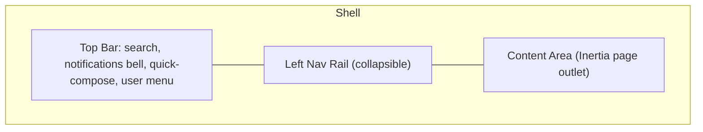

# 08 — Navigation & Information Architecture

## 8.1 App Shell Layout



Three persistent regions: **Top Bar** (global search, notification bell, quick "New Email" button, user/account menu), **Nav Rail** (primary IA, collapsible to icon-only), **Content Area** (renders the current Inertia page, itself often subdivided into list/reading-pane/detail panes per module).

## 8.2 Primary Navigation Tree

Brevo-style information architecture ([43-brevo-parity-plan.md §43.3](43-brevo-parity-plan.md)). French labels are those shown in the UI; the tree is declared in `resources/js/Components/Shell/navItems.ts`. Entries marked *(à venir)* are pre-registered with `hidden: true` until their work package ships.

```
Accueil                          /dashboard
Contacts
  ├─ Contacts (vues)             /contacts
  ├─ Listes                      /contacts/lists
  ├─ Segments                    /contacts/segments
  ├─ Entreprises PagesJaunes     /contacts/pagejaunes
  ├─ Attributs                   /contacts/attributes
  ├─ Imports                     /contacts/imports/new  (historique : /contacts/imports)
  └─ Liste noire                 /contacts/blocklist
Marketing
  ├─ E-mails (campagnes)         /campaigns
  ├─ Formulaires (à venir)       /marketing/forms
  ├─ Modèles                     /templates
  └─ Statistiques                /statistics
Automatisations (à venir)        /automations
Transactionnel
  ├─ Nouveau message             /compose
  ├─ Messagerie                  /mailbox
  ├─ Journaux (à venir)          /transactional/logs
  ├─ Modèles transactionnels (à venir)   /templates?scope=transactional
  └─ SMTP & API (à venir)        /transactional/settings
Paramètres (menu du compte, en haut à droite)
  ├─ Expéditeurs                 /settings/senders
  ├─ Domaines                    /settings/domains
  ├─ Comptes SMTP & rotation     /smtp
  ├─ Pages de désinscription     /settings/unsubscribe-pages
  ├─ Formulaires de mise à jour  /settings/update-profile-forms
  ├─ Suivi (tracking) (à venir)  /settings/tracking
  ├─ Identité visuelle           /settings/branding
  ├─ Utilisateurs & rôles        /admin/users
  ├─ Clés API & webhooks (à venir)  /settings/api
  ├─ Journal d'audit             /admin/audit-log
  └─ Files d'attente             /horizon  (Horizon, hors Inertia)
Aide                             /help
```

The rail renders Accueil, the four sections Contacts / Marketing / Automatisations / Transactionnel, and Aide at the bottom; the `settings` group lives only in the account menu. Former URLs (`/recipients`, `/suppression`, `/reporting`, `/mail/*`) are redirects or retired; the help-center topics keep their historical slugs (`recipients`, `suppression`, `reporting`) with Brevo labels (Contacts, Liste noire, Statistiques).

## 8.3 Route Map (Inertia Web Routes)

Registered in `routes/web/*.php`; permissions are the `can:` middleware of each route.

| Path | Page component | Permission | Notes |
|---|---|---|---|
| `/dashboard` | `Dashboard` | `dashboard.view` | Landing page |
| `/contacts` | `Contacts/Index` | `recipients.view` | Vues, filtres, colonnes, actions groupées |
| `/contacts/{recipient}` | `Contacts/Show` | `recipients.view` | Fiche : Activité, Attributs, Listes, Notes |
| `/contacts/lists` | `Contacts/Lists` | `recipients.view` | |
| `/contacts/lists/{list}` | `Contacts/ListShow` | `recipients.view` | |
| `/contacts/segments` | `Contacts/Segments` | `recipients.view` | |
| `/contacts/segments/new` | `Contacts/SegmentEdit` | `segments.manage` | Constructeur de conditions |
| `/contacts/segments/{segment}` | `Contacts/SegmentEdit` | `segments.manage` | |
| `/contacts/pagejaunes` | `Recipients/PageJaunesSearch` | `recipients.import` | |
| `/contacts/attributes` | `Contacts/Attributes` | `recipients.view` | |
| `/contacts/imports` | `Contacts/Imports` | `recipients.import` | Historique |
| `/contacts/imports/new` | `Contacts/ImportWizard` | `recipients.import` | Assistant en 5 étapes |
| `/contacts/blocklist` | `Contacts/Blocklist` | `suppression.view` | Contacts en liste noire · Rebonds |
| `/campaigns` | `Campaigns/Index` | `campaigns.view` | |
| `/campaigns/{campaign}/setup` | `Campaigns/Setup` | `campaigns.view` | Expéditeur, Objet, Destinataires, Design, Paramètres |
| `/campaigns/{campaign}/design` | `Campaigns/Design` | `campaigns.create` | Éditeur glisser-déposer |
| `/campaigns/{campaign}/report` | `Campaigns/Report` | `reporting.view` | Onglets du rapport |
| `/templates` | `Templates/Index` | `templates.view` | |
| `/templates/{template}/edit` | `Templates/Edit` | `templates.manage` | |
| `/statistics` | `Statistics/Index` | `reporting.view` | |
| `/marketing/forms` | *(à venir)* | `forms.manage` | |
| `/automations` | *(à venir)* | `automations.manage` | Phase F |
| `/compose` | `Composer/Index` | `composer.compose` | |
| `/mailbox` | `Mailbox/Index` | `mailbox.access` | |
| `/transactional/logs`, `/transactional/settings` | *(à venir)* | `transactional.view` | |
| `/settings/senders` | `Settings/Senders` | `senders.manage` | |
| `/settings/domains` | `Settings/Domains` | `senders.manage` | |
| `/smtp` | `Smtp/Index` | `smtp.view` | |
| `/settings/unsubscribe-pages` | `Settings/UnsubscribePages` | `settings.manage` | |
| `/settings/update-profile-forms` | `Settings/UpdateProfileForms` | `settings.manage` | |
| `/settings/branding` | `Settings/Branding` | `settings.branding.access` | |
| `/admin/users` | `Admin/Users` | `users.manage` | |
| `/admin/audit-log` | `Admin/AuditLog` | `audit.view` | |
| `/help` | `Help/Index` | authentifié | Centre de documentation |
| `/preferences/{token}` | contrôleur public | lien signé | Préférences de désinscription |
| `/unsubscribe/{token}`, `/m/{message}`, `/m/c/{campaign}` | contrôleurs publics | lien signé | Désinscription, lien miroir |

Full API surface (JSON) documented separately in [29-api-specification.md](29-api-specification.md) and, for the Brevo parity endpoints, [45-brevo-api-contracts.md](45-brevo-api-contracts.md); the routes above are Inertia page routes returning full page props, not the JSON API.

## 8.4 Navigation Behavior

- Nav rail items filtered by the current user's role/permissions (see [26-rbac.md](26-rbac.md)) — an item is hidden entirely (not just disabled) if the user has no permission for any action within it.
- Active route highlighted with brand-colored left border + filled icon variant (Outlook convention).
- Unread/pending counts shown as `CounterBadge` on: Inbox (unread bounce/reply notices), Outbox (pending count), Scheduled (upcoming count due within 24h).
- Breadcrumbs shown in Content Area header for nested detail pages (e.g. `Campaigns > Q3 Newsletter > Analytics`).
- Global search (Top Bar) queries across Recipients, Campaigns, Templates, and Email History with grouped results, routing to the relevant detail page on selection. Backed by the shared `SearchService`/`SearchProvider` abstraction defined in [40-search-service.md](40-search-service.md), which standardizes the calling contract across all searchable entities without replacing each module's own richer in-page filtering.

## 8.5 Quick Actions

- "New Email" (Top Bar, always visible) opens the Composer overlay regardless of current page.
- Row-level context menu (`...` or right-click) on mailbox/campaign/recipient rows for common actions without navigating away (Move, Delete, Tag, Duplicate, Cancel).

Continue to [09-dashboard.md](09-dashboard.md).
